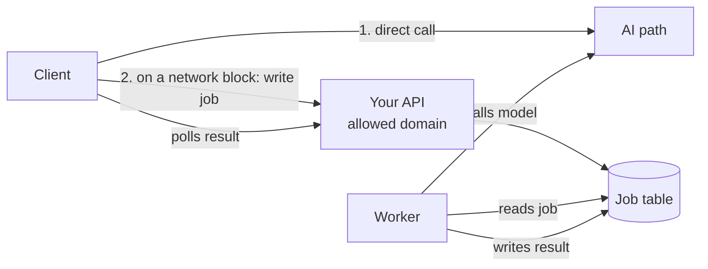

# VPN path switcher

**Scenario:** some customers' VPNs, proxies or firewalls block an application's AI calls, and AI features stop working for those customers.

**If this were the issue, this is how I'd solve it:** try the direct path, detect a network block, switch to a store-and-forward path through your own API (a domain the customer already allows), and switch back when the block clears.

The principle: design for the environment the tool runs in. Don't try to force traffic through a network that blocks it.

## Run it

Needs Node 22.18 or later. No runtime dependencies.

```
npm install
npm test          # 10 tests
npm run typecheck
```

`sim/index.html` is a standalone simulation: flip a firewall on and off and watch requests fail over and recover, with success rates and latency for each path. Open it in a browser. It makes no network calls, and its timings are illustrative.

## How it works



- **Direct first.** Every request tries the direct path with a short timeout (1.5 s by default).
- **Switch on network blocks only.** Timeouts, resets and proxy refusals switch the path. A provider error such as a rate limit is rethrown: sending it the long way round wouldn't fix it, and would hide the real problem.
- **Nothing is lost.** The request that hit the block is retried on the fallback straight away.
- **Switch back on its own.** On the fallback, a probe checks the direct path every 60 seconds. One probe at a time, however many requests arrive.
- **Observable.** `onSwitch` fires on every switch with the cause, for logs and alerts.

```ts
const switcher = createPathSwitcher({
  callDirect, enqueue, waitForResult, probe,
  isNetworkBlock: (err) => isTimeout(err) || isConnReset(err) || isProxyRefusal(err),
  clock: { now: Date.now },
  onSwitch: (e) => metrics.count('ai_path_switch', { to: e.to, cause: e.cause }),
});
const { route, res } = await switcher.send(request);
```

## Diagnose first

The first move isn't code. It's finding which layer blocks the traffic, because each layer needs a different fix.

| Symptom | Likely cause | Fix |
| --- | --- | --- |
| DNS lookup fails | Provider domain blocked at DNS | Same-origin gateway (route through your domain) |
| Connection times out or resets | Firewall drops traffic to the provider | Same-origin gateway; the fallback in this package |
| TLS error, certificate mismatch | Proxy inspects TLS and swaps certificates | Don't pin certificates on the client; trust the customer's proxy CA where policy allows |
| HTTP 403 from the proxy, often a "category blocked" page | Customer's security tools block AI services **on purpose** | Not a technical problem: see "When the block is deliberate" |
| Streaming answers cut off or never start | Proxy buffers or kills long-lived connections (SSE, WebSockets) | Fall back to plain request and polling; shorter responses |
| Fails only on large inputs | Proxy size limits, or data-loss-prevention scanning | Smaller payloads; check what the DLP rule is matching |
| Works on office network, fails on VPN (or the reverse) | Different egress rules per network | Same diagnosis per network; log which network a failure came from |

Collect this per customer before changing anything: the error, the network it came from, and whether a plain HTTPS request to your own domain works from the same machine.

## If the first fix was already tried

A gateway or fallback like this one is a common first fix. If it had been tried and didn't work, the reason points to the next step:

1. **The gateway was blocked too.** The proxy probably blocks by category, and the gateway's domain got classified as AI. Find out whether that's deliberate. If it's an overbroad rule, the customer's IT allowlists the domain (step 4). Don't disguise the traffic to slip past the filter: that's the same as routing around a deliberate block.
2. **It worked but was too slow.** Store-and-forward adds polling delay. Shorten the poll interval, use long polling (the server holds the request open until the result is ready, within the proxy's timeout), or send short answers first and details after.
3. **Streaming broke.** Detect it and switch the response style, not just the path: plain request and response, no SSE or WebSockets, for that customer.
4. **Network change on the customer's side.** Publish the exact domains and IP ranges your AI traffic uses, so the customer's IT can allowlist them. Offer fixed egress IPs, or private connectivity (AWS PrivateLink, Google Private Service Connect) so traffic never crosses the public internet.
5. **Run it inside the customer's network.** A small relay or the whole AI service deployed in the customer's own cloud account, or a model they host themselves. This is the heaviest option, for the largest customers or the strictest policies.
6. **Degrade gracefully.** Whatever happens, the product must still work without AI: hide or disable AI features cleanly, say why, and keep the non-AI workflow intact.

## When the block is deliberate

Many companies now block AI services on purpose, through data-loss-prevention or web-filtering policy, to control where their data goes. Routing around that is a policy violation, not a fix, however good the code.

- If the block is deliberate, the answer is a conversation with the customer's security team: what data goes to which model, where it's processed and kept, under what terms. Then an approved route (allowlisting, private connectivity, or in-network deployment).
- Ship the fallback for *accidental* blocks: broken proxies, overbroad rules, streaming limits. Make it a per-customer setting that the customer's admin can turn off.

## Security

- **No provider keys on the client.** The direct path should go to your own gateway, which holds the keys. A client that calls the provider with an embedded key has a leaked key.
- **The job table holds customer data.** Requests and answers sit in it between write and read. Encrypt at rest, delete each job when it's read or after a short time limit, and never log the content.
- **Job ids must not be guessable, and must be checked.** The poll endpoint returns a result only to the user and tenant that created the job. A guessable id plus a missing check lets one customer read another's answers.
- **Same limits on both paths.** Rate limits, input size limits and authentication apply to the fallback exactly as to the direct path, so it can't become a way around them.
- **Probes carry no data.** The probe is a request with no customer content, so a probe that leaks into logs or a proxy reveals nothing.
- **Data residency.** The worker calls the model from your servers, possibly from a different region than the direct path. Check that this matches what each customer agreed to.
- **Retries are safe.** A request may be retried on the fallback after a direct attempt that actually reached the model. If the AI step can trigger an action (a refund, a write), give each request an idempotency key, so a retry can't do it twice.

## Caveats

- Detection relies on `isNetworkBlock` classifying errors correctly. Get it wrong one way and real outages look like blocks (requests reroute instead of alerting); the other way and blocks look like errors (no failover). Test it against real failures from each customer network.
- The 1.5 s timeout assumes the direct path starts answering quickly. With streaming it means the first byte; without streaming, a long answer needs a longer timeout or the healthy path looks blocked.
- One switcher per client session. Sharing one across many customers' traffic on a server would let one blocked customer switch everyone.

## Layout

```
src/switcher.ts         the switcher
test/switcher.test.ts   failover, switch back, error classes, probe under load
sim/index.html          interactive simulation
```
